<!-- Las imagenes de este perfil se generan con assets/gen_pixel.py (python assets/gen_pixel.py) -->





<kbd>▶ VER DETALLES</kbd>


<kbd>▶ VER DETALLES</kbd>



<kbd>▶ VER DETALLES</kbd>



<kbd>▶ VER DETALLES</kbd>



<kbd>▶ VER DETALLES</kbd>



<kbd>▶ VER DETALLES</kbd>









