<!-- Las imagenes de este perfil se generan con assets/gen_pixel.py (python assets/gen_pixel.py) -->

> Desarrollador de software en la **Institución Universitaria de Colombia** y estudiante de **Ingeniería de Software**.
> Construyo plataformas reales con IA: chatbots, sistemas para consultorios y herramientas para estudiantes.
> Me apasionan el diseño, el frontend y los videojuegos, y hacia allá voy.

<b>Ver detalles de SOFIA</b>

Plataforma para el consultorio jurídico universitario con chatbot web, IA/RAG y agendamiento conversacional.

- Chatbot web con IA conversacional multiestado
- RAG con OpenAI: búsqueda semántica, re-ranking y generación
- Agendamiento completo por chat
- Multi-tenancy con aislamiento por `tenantId`
- Dashboard con métricas y exportación PDF/Excel
- 6 microservicios Node.js/Express + 1 Python FastAPI · PostgreSQL + pgvector + Qdrant · Railway

<b>Ver detalles de SICOP</b>

Sistema administrativo para consultorios jurídicos universitarios: casos, citas, documentos y certificaciones.

- RBAC con 6 roles y JWT con refresh tokens
- PDFs con verificación por QR
- Flujo de firmas multirol ordenado por jerarquía
- Recordatorios automáticos 24 h y 15 min antes
- Ciclo de vida de casos con semáforo de plazos y auditoría completa
- Integración SOFIA ↔ SICOP

<b>Ver detalles de App Psicología IUDC</b>

Sistema de salud mental universitaria: chatbot emocional con IA, copiloto clínico y app móvil.

- Chatbot emocional con GPT-4o-mini + RAG
- Copiloto clínico para practicantes de psicología
- App Flutter con Google Sign-In (Android, iOS y web)
- Push notifications con Firebase y mensajería asíncrona con RabbitMQ
- Más de 10 microservicios NestJS · MySQL + Redis + MinIO · tests con Jest, Vitest y Playwright

<b>Ver detalles de Kivo</b>

Plataforma web para crear personajes y vivir historias conversacionales con IA, instalable como PWA.

- Creador de personajes por pasos, con personajes secundarios y tarjetas de lore
- Chat narrativo con memoria, voces de narración y ramas de la historia
- Login con Google y verificación por código · Postgres con Row Level Security
- Internacionalización, catálogo con búsqueda y moderación

<b>Ver detalles de Connexia</b>

CRM que reúne en un solo lugar los mensajes, leads y ventas de un negocio.

- Canales: WhatsApp, Messenger, Instagram, correo, SMS y llamadas
- Captura de leads desde Meta Ads y TikTok Ads, con flujos automáticos
- Pagos, catálogo y agenda de reservas
- Más de 20 microservicios .NET 9 con gateway GraphQL + gRPC

<b>Ver detalles de PythonEscape</b>

Aprende Python jugando. El videojuego que despertó un gran sueño.

- 7 escenarios conectados con minimapa y audio ambiental por habitación
- Pygame con física y colisiones · tests con pytest · arquitectura SOLID

